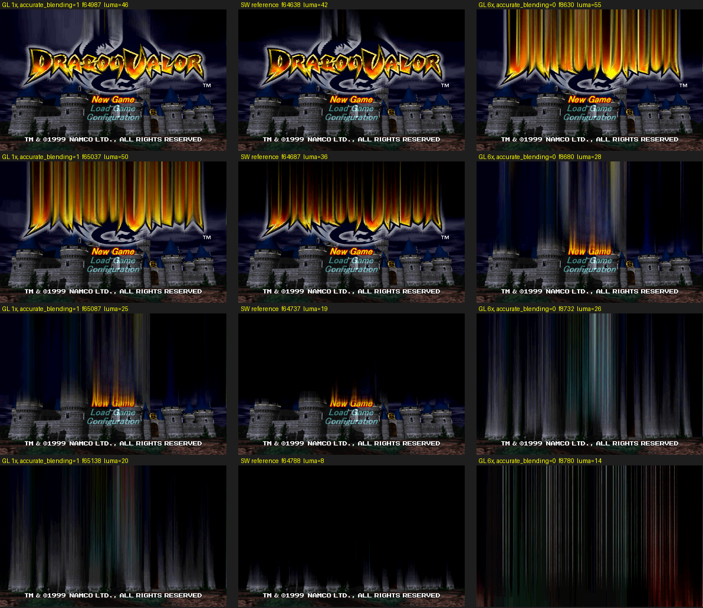
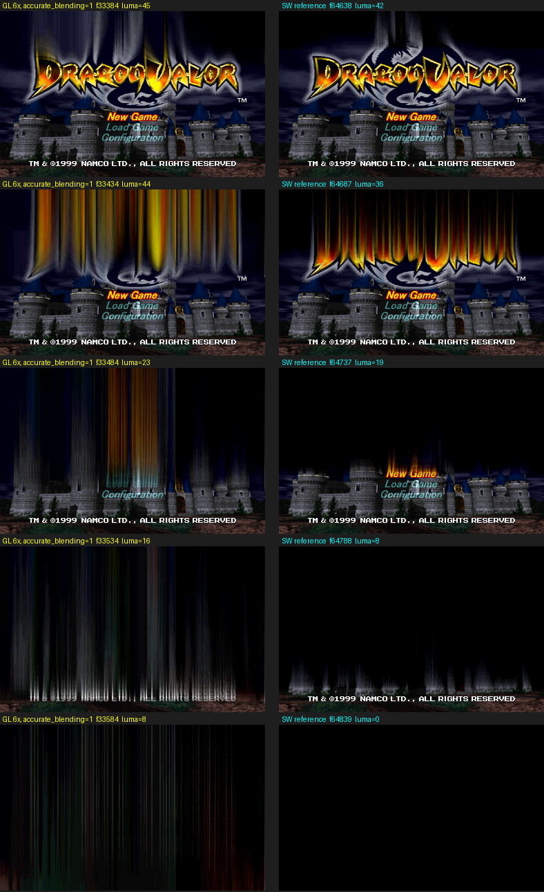

# History: what the PAL bring-up established (2026-10-13 / 14)

The project started on the European release (SCES-01705 / SCES-11705, 50 Hz)
because that was the disc at hand. Once the USA discs arrived the USA version
became the project (native 60 Hz) and the PAL tree was deleted on 2026-10-14.
Everything below was learned on PAL and applies to this build; the PAL
addresses are given where they differ.

## Bring-up facts

- Both discs of a set carry the same boot EXE; `update_disc_set.py` registers
  the pair. Mid-session disc swap is not implemented by the framework (P3).
- `generate` is deterministic: two independent runs produced byte-identical
  `generated/` trees (PAL: 35 shards, 1,304,402 lines, 1967 dispatch entries).
- Generic extractor base recovery, header-pointer fit and the EXE's own entry
  code agree on the overlay slot: the heap base set at `0x80012EA8`
  (PAL `0x800BC268`, USA `0x800BBEF0`), into which the five `BIN/*.BIN` mode
  modules are read whole. See [`AOT.md`](AOT.md).

## Controller

- The runtime defaults player 1 to the keyboard: the `"auto"` branch in
  `main.cpp` is behind a `PSX_DEBUG_TOOLS` macro that `runtime.cmake` never
  defines, so a gamepad was never opened until `[controller] p1_device = "auto"`.
- In `"digital"` mode the stick is folded into the D-pad and the character
  walks in 8 directions; the game reads the analog axes, so
  `default_mode = "dualshock"` (player-confirmed).

## Rendering: scene-change dissolve

The game's melt transition (title/menu → demo, scene cuts in the demo) smears
the previous frame into vertical streaks through repeated semi-transparent
feedback. Compared on the same guest frames (instances started from the same
Start press are offset by a constant frame count):

- GL 1x, `accurate_blending = true` → matches the software reference closely.
- GL 6x, `accurate_blending = true` → taller streaks lingering ~1 s longer.
- `accurate_blending = false` → clearly exaggerated.

Cosmetic; gameplay rendering is identical in both renderers. Evidence:
`assets/dissolve-gl1x-sw-glab0.png`, `assets/dissolve-gl6x-vs-sw.png`.

  

  
Candidate upstream report (feedback effects at internal scale > 1x).

## First play session (PAL, 22 min, human on the pad)

Overworld, dungeon, town, dialogue, inventory/magic menu, item pickups,
memory-card save: all fine; player reported no visual, audio, input-latency
or slowdown issues. FPS locked at 50 except one 30 s window at 44 fps that
coincided with a runtime overlay-compile burst — the motivation for the AOT
static shard, which removed it (and the ~12k dirty-RAM interpreted blocks).

## Framework quirks met

- `setup_project.ps1` on Windows drops empty-string args (PowerShell 5.1):
  pass `-Description/-Publisher/-Year/-Region` and `-BootExe`, or the probe
  dies and the `SLUS_01234` placeholder survives in CMake/codegen/symbols.
  When run with output redirected it also prints a false "Generate failed"
  (stderr from `git commit` inside its try block); `generated/` ends up staged.
- The pitfalls that still apply were moved to the live docs: the `rebuild`
  debug flag, muting (`SDL_AUDIO_DRIVER=dummy`), the freeze dumps, the
  `debug_key` / `ping` quirks (`DEVELOPMENT.md`) and the
  `GAME_OVERLAY_STATIC_C` argument order (`AOT.md`).
- Frame generation (`PlaySmooth.bat`, removed from the USA project on
  2026-10-14) and dynamic resolution compete for GPU
  time; with dynamic resolution on, the generation breaker trips
  intermittently (felt as stutter). Fixing the internal resolution stabilises
  it. Of little value on the 60 Hz USA build.
